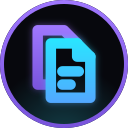
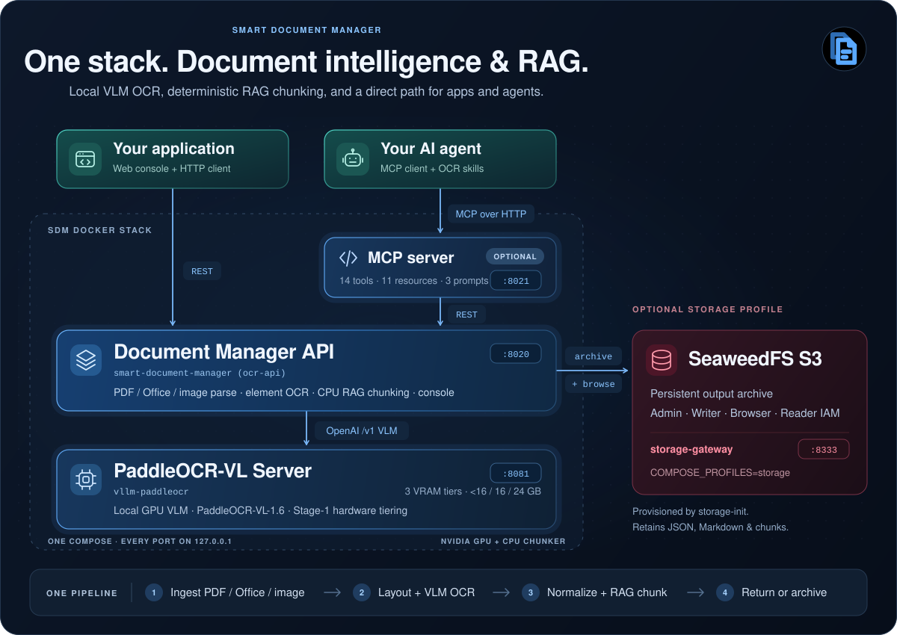
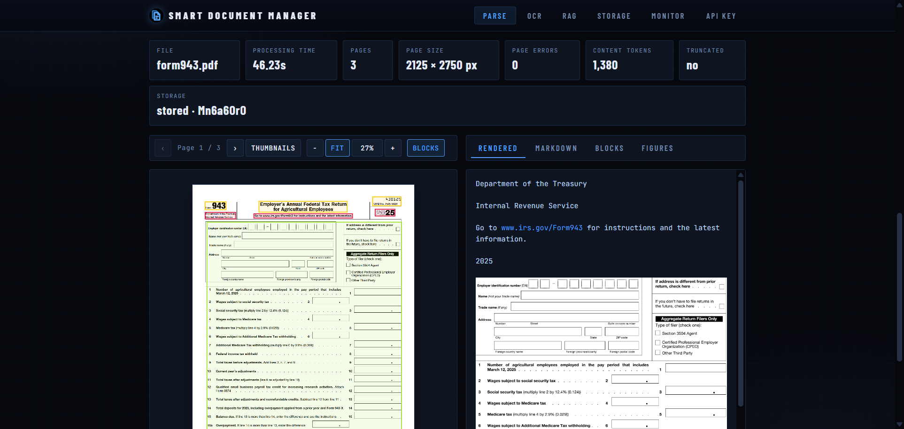
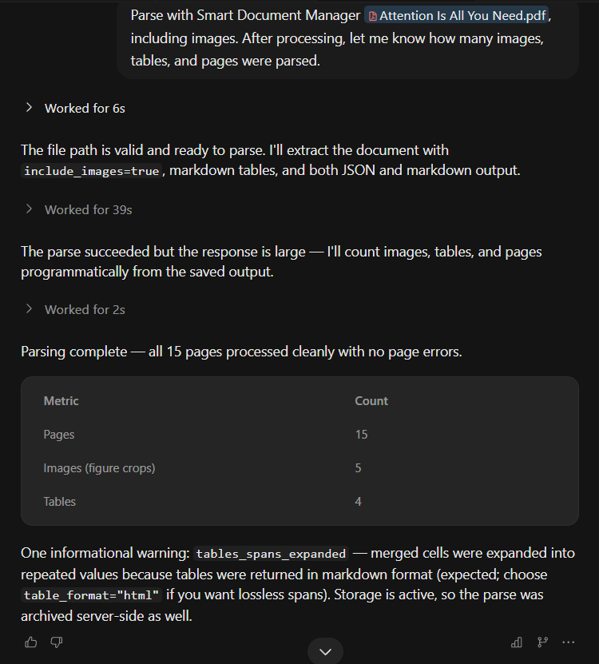

  

<h1 align="center">Smart Document Manager (SDM)</h1>

## 💡 What is it?

**Smart Document Manager (SDM)** aims to be the shortest path from a pile of
PDFs, scans and Office files to text a machine can actually use — Markdown,
layout-tagged JSON blocks and retrieval-ready chunks — on hardware you already
own. Layout analysis, recognition and chunking happen on your machine rather
than behind a hosted document-AI API: a single consumer NVIDIA card is enough.

Concretely, it is an easy and efficient front door to **PaddleOCR-VL served by
vLLM**: a layout model finds the regions of each page — titles, paragraphs,
tables, formulas, figures, headers, footers, seals — a 0.9B vision-language
model reads each region in its own terms, and the service stitches the result
back into a reading order, with every block carrying its page, bounding box
and layout tag. That is what separates an extraction you can trust from a wall
of text with the table flattened into it — and running it should cost you one
command rather than a per-page bill.

**Running well on consumer-grade hardware is a design constraint, not a side
effect.** The model is small on purpose — a 0.9B-class VL model, not a 7B one
— and only one service in the stack loads it at all. A pre-start autotuner
then fingerprints the GPU it actually finds and calibrates concurrency and
thread counts against a bundled corpus, so the stack tunes itself to your
hardware instead of assuming a datacenter.

**Your documents stay on your machine — that is the reason this project
exists.** No page is ever sent to a hosted AI API, the way OCR features are
usually wired: the model runs in your own container, so nothing leaves your
machine or your VPN. Storage follows the same rule — the optional archive is
a SeaweedFS S3 store you run yourself, on this host, and the results in it
belong to you. The one boundary the stack cannot police is the agent on the
other side of MCP: this project keeps its own work on your machine, it cannot
make a cloud-hosted agent private.

## ⚙️ The stack

  

## 🛠️ What can I do with this software?

* **Turn documents into structured text.** You hand it a PDF, an image or an
  Office file — `.docx`, `.pptx`, `.xlsx` and their older and OpenDocument
  cousins — and it returns page Markdown plus JSON blocks that know what they
  are: a title, a paragraph, a table with its cells, a formula in LaTeX, a
  figure with its caption, a header or footer kept apart from the body.
  Office files are converted to PDF inside the container first, so they
  follow the same path and keep the same guarantees.
* **Recognize a single element when a whole page is too much.** One image,
  one task — `ocr`, `table`, `formula`, `chart`, `spotting` or `seal` — and
  you get back exactly that: the table markup, the LaTeX, the chart data, the
  text boxes with their coordinates.
* **Prepare a RAG corpus without writing a chunker.** An explicit chunking
  step packs the parse output into token-bounded, section-aware units —
  counted with the model's own tokenizer, deterministic, on CPU, without
  calling the model again. Tables and code blocks stay whole, page furniture
  stays out of the body, and every chunk keeps its provenance: document,
  page, block and section. You can refine the cuts by hand afterwards; the
  model is never re-run.
* **Give a coding agent eyes for documents — and let it drive.** With the MCP
  server enabled, Claude Code or any other MCP client operates the whole
  stack in natural language: 14 tools cover everything the API can do —
  check readiness, parse a document, recognize an element, create and refine
  chunks, browse the archive — with no OCR vendor in the path. The server
  also ships its own documentation, so the same agent can read the docs and
  explain back to you how it all works. What the agent's own model does with
  the text it reads is between you and that agent.
* **Give that agent the playbook, not just the tools.** The bundled
  `ocr-skill/` directory ships two drop-in Agent Skills: `smart-document-manager`
  teaches the agent to pick the right tool, respect the confirmation gates
  around deletions and recover when a call fails; `smart-document-reader` teaches it
  to read a parse result, or its stored archive, correctly — reading order,
  tables, captions, footnotes, provenance — without running OCR again. Same agent, same tools
  — noticeably better with both.
* **Drive it from a browser instead of a terminal.** The built-in web console
  exposes the whole API as a point-and-click surface — parse a document and
  inspect it page by page with the detected blocks drawn over it, run
  element tasks, build and edit RAG chunks, browse and delete archives, watch
  live service telemetry. It is the quickest way to feel what the stack can
  do before you automate any of it.
* **Tailor the deployment to your needs.** The stack is composable — the MCP
  server, the web console, the Swagger docs and the S3 archive are each a
  switch, so you run only the modules you use and nothing unused stays
  reachable. API, MCP and storage each take their own credentials, and the
  launcher refuses to start if two of them share a token.

## 🚀 How do I start?

Three things first: Docker with Compose 2.24.4 or newer and Python 3.11 or
newer on PATH; an NVIDIA GPU that Docker can see — NVIDIA Container Toolkit
on Linux, Docker Desktop with the WSL 2 backend on Windows; and an `.env`
copied from `.env.example` with its tokens filled in. Then one command:

    pwsh stack.ps1 up -Wait     # Windows (PowerShell)
    bash stack.sh up --wait     # Linux / macOS

The launcher verifies the tokens, builds the images, starts the model server,
waits for it, lets the API calibrate itself against your GPU, then starts
MCP. The first run downloads the model and runs the full calibration, so it
is a good deal slower than every run after. When it finishes, the API answers
on `http://127.0.0.1:8020` with the web console already on it, and the MCP
endpoint on `http://127.0.0.1:8021/mcp`.

`down` stops it again, `logs` follows it, `status` shows what is running —
[`cli.html`](guide/cli.html) covers the rest.

## 🖥️ How do I interact with it?

Open that address, register the API key once, and every option is on the
page: drop a document, parse it, and read the result beside the page it came
from — then carry the settings that worked into your own client.

  

The second surface is an agent, and it needs no screen at all: with the MCP
server enabled and the skills installed, the same operations happen in
conversation. You say what you want, it picks the tool and fills in the
parameters.

  

## 📚 Where do I learn more?

The `guide/` directory is a complete field guide you read in the browser —
six standalone pages that open straight from disk, no server or network
needed:

* [`getting-started.html`](guide/getting-started.html) — the first run end to
  end: the `.env`, the GPU prerequisites, `up`, connecting an agent,
  installing the skills, your first extraction.
* [`cli.html`](guide/cli.html) — the launcher commands: start, stop, logs,
  previewing a plan, recovering a stuck stack.
* [`environment.html`](guide/environment.html) — the `.env` file explained:
  every parameter, searchable, with the values worth changing first.
* [`architecture.html`](guide/architecture.html) — how the pieces fit
  together: API, model server, MCP, the agent skills and the optional archive.
* [`document-pipeline.html`](guide/document-pipeline.html) — how a page
  becomes labelled regions, recognized content and a reading order, and how
  to read the JSON it returns.
* [`rag-chunking.html`](guide/rag-chunking.html) — what the chunker does with
  a parse result: budgets, sections, protected blocks and provenance.

## 🤝 How can I contribute?

**The project is open source under [AGPL-3.0](LICENSE) and anyone who wants to
contribute is welcome.** One thing is worth saying up front, though: it was
built with very heavy use of AI coding agents, and it expects you to work the
same way.

So if you find a bug or want a feature, point the coding agent you prefer at
the repository before you write anything. `AGENTS.md`, the `guide/` pages and
the MCP server's own documentation resources exist precisely so that an agent
can read this codebase and work out what is really going on — which file,
which setting, which service. Then **open an issue** with what it found: how
to reproduce it, the trail it followed, what it believes the cause to be.

That is where the conversation starts, not where it ends. How a bug should be
fixed — or whether a feature belongs in the stack at all — gets decided
afterwards, in the issue.

On our side the project keeps moving, and two directions are already set. The
first is **following PaddleOCR and vLLM as they grow**, so that what lands
upstream becomes an option here rather than a reason to rewrite. The second
is **widening the hardware it runs on**, so that a consumer NVIDIA card is the
first accelerator it supports well rather than the only one. Anyone who wants
to push in either direction is especially welcome.

---

  <strong>📄 HAPPY SMART DOCUMENT PARSING! 🔎</strong>

